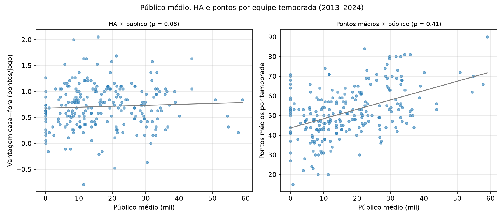
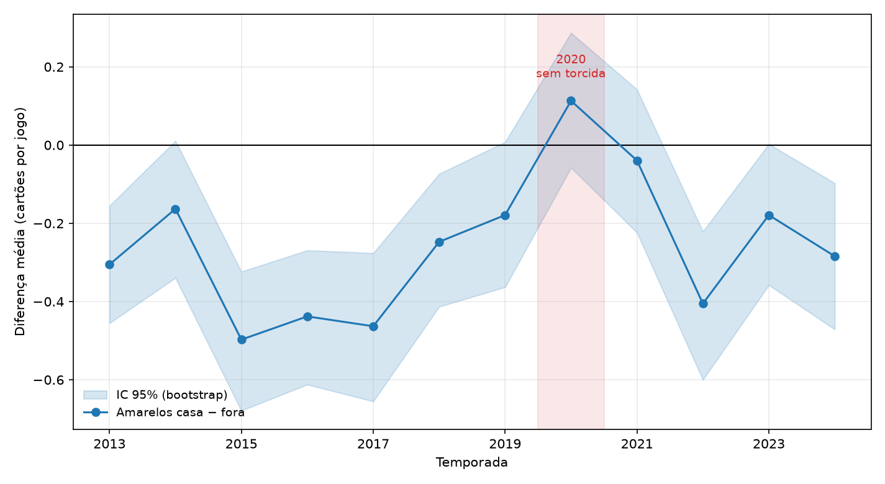

# Home advantage in Brazilian Série A: a model-based analysis of 12 seasons (2013–2024)

José Inamar de Medeiros Júnior

Universidade Federal do Rio Grande do Norte (UFRN), Centro de Ensino Superior do Seridó (CERES), Bacharelado em Sistemas de Informação, Caicó, RN, Brazil

## Abstract

Home advantage is one of the most robust regularities in team sports, but its magnitude and stability in Brazilian football remain debated. We study 4,559 matches of the Brazilian Série A from 2013 to 2024 using an open, MIT-licensed match database. We combine the Pollard points index, a formal change-point model, and a Poisson attack–defence model that separates team quality from the home effect. Home teams won 48.4% of matches and captured 63.0% of points (95% CI 61.7–64.3). The annual series falls from 65.0% in 2013–2018 to 61.0% in 2019–2024 (difference 4.0 pp; cluster-bootstrap CI 0.9–6.6), with the break date estimated at 2019. The Poisson model tells the same story in goal space: the home team's goal multiplier fell by 12.0% (from 1.565 to 1.377; CI −18.1% to −5.5%), reducing the home-goal premium from +56.5% to +37.7%. About 2.2% of the variance in team-season home advantage is between teams, indicating that home advantage is predominantly a league-wide phenomenon rather than a stable club trait. Attendance is only weakly associated with home advantage (ρ = 0.08) although strongly associated with team strength (ρ = 0.41). Referee cards around the 2020 ghost games move in the expected direction but remain imprecise. The decline is robust to team quality and season effects and is not attributable to a single channel; we discuss implications for forecasting, competitive balance, and the interpretation of post-2019 benchmarks.

**Keywords:** home advantage; Brazilian football; Pollard index; Poisson model; change-point; COVID-19.

**JEL codes:** C12, C23, Z20.

## 1. Introduction

Home advantage — the systematic tendency of teams to perform better at home than away — is one of the most consistent findings in the sports economics literature. It has been documented in football, basketball, ice hockey, and other team sports, with magnitudes that vary across countries, competitions, and periods (Pollard, 1986; Nevill and Holder, 1999). In football, the phenomenon is usually summarized by the share of points won by home teams. Values above 50% in a balanced double round-robin indicate an advantage; in many professional leagues the observed share is between 55% and 65% (Pollard, Silva and Medeiros, 2008; Almeida, Oliveira and Silva, 2011).

Brazilian Série A is an interesting laboratory for three reasons. First, it combines a long double round-robin with large territorial distances and a heterogeneous set of clubs, which makes travel, stadium familiarity, and crowd support plausible but potentially offsetting mechanisms. Second, the league experienced two salient shocks in a short window: the introduction of the video assistant referee (VAR) in 2019 and the COVID-19 pandemic in 2020–2021, when matches were played without crowds for part of the period. Third, the Brazilian literature is dominated by descriptive studies with short samples or aggregate comparisons, while formal models that separate team quality from the home effect are scarce. Referee decisions are also sensitive to crowd pressure (Nevill et al., 2002; Garicano, Palacios-Huerta and Prendergast, 2005; Boyko, Boyko and Boyko, 2007; Dohmen, 2008; Buraimo, Forrest and Simmons, 2010; Sutter and Kocher, 2004), which makes the Brazilian ghost-game episode particularly informative.

This paper asks three questions. How large was home advantage in Série A between 2013 and 2024? Did it change after 2018, and when? Which channels are consistent with the observed pattern? We answer them with a reproducible pipeline built on an open match database, the Pollard index, a change-point model, and a Poisson attack–defence model. The Poisson model is particularly useful because raw home–away differences mix the home effect with team quality: a strong home team may score many goals at home simply because it is strong. By estimating attack and defence for each team, season effects, and a separate home parameter, we isolate the within-match asymmetry that the descriptive index only approximates.

The paper contributes in four ways. First, it provides a fully reproducible 12-season series built from an MIT-licensed source, with explicit validation against an independent public dataset. Second, it estimates the level shift formally and reports a cluster-bootstrap interval for the change, rather than relying on visual inspection. Third, it estimates a Poisson attack–defence model with a home-by-period interaction, which shows that the decline is present in goal space and survives controls for team quality and season. Fourth, it quantifies the heterogeneity of home advantage across teams and relates it to attendance, context, and referee cards. The results are descriptive and observational; we do not claim causal identification.

The remainder of the paper is organized as follows. Section 2 describes the data and validation. Section 3 presents the methods. Section 4 reports the results. Section 5 discusses mechanisms, limitations, and implications. Section 6 concludes.

## 2. Data

### 2.1 Match data

The primary data are the 2013–2024 seasons of the Brazilian Série A, obtained from the `BrazilianFootball/Data` repository (MIT licence), which extracts match information from the electronic match reports (borderôs) of the Brazilian Football Confederation (CBF). The final sample contains 4,559 matches: 380 per season, except 2016, which has 379 because the Chapecoense–Atlético-MG match was cancelled after the Chapecoense air disaster. The 2020 season ran from 8 August 2020 to 25 February 2021 because of the pandemic. Each match record includes date, home and away teams, goals, stadium, and disciplinary cards. The data do not include attendance or referee identity; these are obtained from the Base dos Dados/Transfermarkt compilation for the same period.

The sample starts in 2013 for a data-availability reason: the CBF's electronic match reports begin in that year, and the MIT-licensed repository covers 2013 onwards. Earlier seasons would require a different, non-electronic source and are outside the scope of this paper. This restriction is a feature for reproducibility: the entire match-level analysis can be rebuilt from a public, permissively licensed source.

### 2.2 Validation

We validate the match results against OpenFootball (CC0). For 2018–2024, 2,658 of 2,660 matches have identical scores (99.92%). One score discrepancy remains for Internacional vs Atlético-MG in 2019 (the CBF-derived file records 0–0; OpenFootball records 2–1), and one match in 2023 is a two-day game with a date mismatch. Both are documented in the replication material. Recomputing the champions from the match results yields the official winner in all 12 seasons (2013–2024), including Botafogo-RJ in 2024.

### 2.3 Attendance, referees, and cards

Attendance is available for 4,555 of 4,559 matches (99.9%). There are 628 zero-attendance records: 598 are real (380 in 2020 and 218 in 2021); the other 30 are sparse zeros in other seasons, kept as records but possibly containing errors. Referee identity is available for 4,541 matches (99.6%). Yellow and red cards are available for all 4,559 matches, with one unassigned card in 2022 (a malformed record). Attendance and referee data come from Base dos Dados/Transfermarkt; 2024 attendance was supplemented by FBref (90 matches). These data are used only in the descriptive analyses; the main results rely on the MIT match data.

### 2.4 Definitions and descriptive statistics

Results are derived from the score: a win earns three points, a draw one, and a loss zero. The Pollard index (Pollard, 1986; Matos, Amaro and Pollard, 2020) for season t is

`HA_t = 100 × P^H_t / (P^H_t + P^A_t)`

where P^H_t and P^A_t are the total points won by home and away teams in season t. A value of 50 indicates neutrality; values above 50 indicate a home advantage. We also use the team-season home advantage HA_it = home points per game_it − away points per game_it, which is the unit of the heterogeneity analysis.

Table 1 reports the season-level descriptives. Home teams won 48.4% of matches, draws accounted for 26.9%, and away teams won 24.7%. The average number of goals was 1.41 for home teams and 0.96 for away teams. The aggregate Pollard index was 63.0% (95% CI 61.7–64.3), 13.0 percentage points above neutrality.

**Table 1. Season-level descriptives, Brazilian Série A, 2013–2024.**

| Season | Matches | Home / draw / away (%) | Goals home / away | Pollard (95% CI) |
|---:|---:|---:|---:|---:|
| 2013 | 380 | 48.4 / 28.4 / 23.2 | 1.47 / 0.99 | 63.95 (59.28–68.24) |
| 2014 | 380 | 51.8 / 24.2 / 23.9 | 1.42 / 0.84 | 65.17 (60.56–69.65) |
| 2015 | 380 | 52.6 / 23.9 / 23.4 | 1.46 / 0.90 | 65.87 (61.30–70.12) |
| 2016 | 379 | 53.3 / 24.8 / 21.9 | 1.49 / 0.92 | 67.11 (62.80–71.43) |
| 2017 | 380 | 43.9 / 27.1 / 28.9 | 1.38 / 1.04 | 58.24 (53.43–62.64) |
| 2018 | 380 | 53.2 / 28.9 / 17.9 | 1.38 / 0.79 | 69.51 (65.35–73.68) |
| 2019 | 380 | 48.2 / 26.1 / 25.8 | 1.38 / 0.92 | 62.25 (57.77–67.08) |
| 2020 | 380 | 45.0 / 28.4 / 26.6 | 1.41 / 1.07 | 60.17 (55.44–64.60) |
| 2021 | 380 | 45.8 / 29.7 / 24.5 | 1.27 / 0.94 | 61.83 (57.20–66.21) |
| 2022 | 380 | 44.2 / 28.4 / 27.4 | 1.41 / 0.98 | 59.30 (54.49–63.87) |
| 2023 | 380 | 46.8 / 25.8 / 27.4 | 1.42 / 1.07 | 60.65 (56.10–65.15) |
| 2024 | 380 | 47.4 / 26.6 / 26.1 | 1.41 / 1.03 | 61.69 (57.06–66.10) |

Notes: Pollard index = 100 × home points/(home points + away points). Confidence intervals are descriptive 95% bootstrap intervals based on 4,000 match resamples; they do not correct for within-season team dependence. Source: BrazilianFootball/Data (MIT).

## 3. Methods

### 3.1 Pollard index and inference

The Pollard index is our descriptive measure of the aggregate advantage. We report season-level values and an overall 95% bootstrap interval based on resampling matches with replacement (4,000 replications). Because matches involving the same teams are not independent, the annual intervals are descriptive; for the level shift we use a cluster bootstrap that resamples entire seasons. This distinction matters: the annual intervals answer “how much would the season mean vary if we resampled its matches?”, not “what is the sampling uncertainty of the league parameter?”.

### 3.2 Change-point model

Let y_t be the Pollard index in season t. We estimate the mean-shift model (Chow, 1960)

`y_t = α + β · 1(t ≥ τ) + ε_t`

where τ is a candidate break date. We estimate τ by minimizing the sum of squared residuals over all candidate dates with at least three seasons on each side. The estimated break is the date that best separates two constant means. We report the pre- and post-break means and the difference; the 95% interval for the difference comes from a cluster bootstrap that resamples seasons within each period (5,000 replications). This is a descriptive change-point model; it does not identify the cause of the break.

### 3.3 Poisson attack–defence model

To separate the home effect from team quality, we model the two goal counts of each match. Let i be the home team, j the away team, and t the season. The expected goals are

`log λ^H_ijt = μ + a_i − d_j + γ + δ · 1(t ≥ 2019) + θ_t`

`log λ^A_ijt = μ + a_j − d_i + θ_t`

we use a reference team with attack and defence set to zero; the effects of the other teams are relative to it. Here a_i is the attack of team i, d_i its defence, γ the home advantage before 2019, δ the change in the home advantage after 2019, and θ_t a season fixed effect. The model is a Poisson attack–defence specification in the tradition of Maher (1982) and Dixon and Coles (1997); we do not apply the low-score correction because the focus is the home parameter, not score prediction.

We estimate the model by iteratively reweighted least squares (Poisson IRLS) with a reference team and a reference season. Standard errors are cluster-robust at the match level: the two goal observations of the same match are correlated, and clustering by match accounts for that dependence (Cameron, Gelbach and Miller, 2008; Cameron and Miller, 2015). We also report the Pearson dispersion statistic; values near one are consistent with the Poisson variance assumption, and values above one would call for quasi-Poisson or negative-binomial standard errors. The quantities of interest are γ, γ+δ, and δ. We report both the log coefficients and the multiplicative effects exp(·)-1, which have a simple interpretation: the percentage by which the home team's expected goals exceed the away team's expected goals, holding attack, defence, and season fixed.

### 3.4 Heterogeneity

We decompose the variance of team-season home advantage with a one-way random-effects model:

`HA_it = μ + u_i + e_it`

where u_i is a team effect and e_it is a team-season residual. The intraclass correlation ρ = σ^2_u/(σ^2_u+σ^2_e) is the share of variance that is between teams. A value near zero would imply that home advantage is a league-wide phenomenon; a large value implies that clubs differ persistently. The decomposition is descriptive and does not impose a distributional model on u_i.

### 3.5 Cards

For the disciplinary extension, let D_ijt be the difference between yellow cards received by the home and away teams in match t. We estimate

`D_ijt = β_0 + β_1 Post_t + α_i + α_j + ε_ijt`

where Post_t = 1 for 2020 and α_i,α_j are home and away team fixed effects. The coefficient β_1 is a difference-in-differences estimate: it compares the home–away card gap in 2020 with the gap in 2019, after absorbing time-invariant team differences. Standard errors are conservative: we compute one-way cluster-robust variances by home team and by away team and take the larger standard error, which avoids the negative-variance problem that multiway inclusion–exclusion can produce in small samples (Cameron and Miller, 2015). The estimate is descriptive; cards reflect both referee decisions and player behaviour. The match JSON also marks penalty goals with `PN`; we use this marker in a pilot, but do not observe missed or awarded penalties.

### 3.6 Attendance

At the team-season level, we compute Spearman correlations between average attendance and (i) team-season home advantage and (ii) points. Attendance is endogenous — it depends on opponent, phase, prices, and weather — so the correlations are descriptive and should not be read as causal effects.

### 3.7 Reproducibility

All steps are scripted. The match base is built by `scripts/build_mit_base.py`; the descriptive figures and tables by `scripts/analyze_artigo.py`; the Poisson model and variance decomposition by `scripts/analyze_models.py`; the cards analysis by `scripts/analyze_cards.py`. The raw match JSONs are not redistributed; the build is pinned to a specific commit of the MIT repository. The repository also contains the dashboard used to explore the data.

## 4. Results

### 4.1 The level and the shape of home advantage

Home advantage in 2013–2024 was large by international standards: 63.0% of points went to home teams, 13.0 percentage points above neutrality. The season-level series, however, is not flat (Figure 1). It ranges from 58.2% in 2017 to 69.5% in 2018, and the high values of 2015–2018 are followed by a lower plateau after 2019. The visual impression is confirmed by the change-point model: the break date that minimizes the sum of squared residuals is 2019, with a pre-break mean of 65.0% and a post-break mean of 61.0% (difference 4.0 pp; cluster-bootstrap 95% CI 0.9–6.6). The 2020 season, played without full crowds, recorded 60.2%; the 2022–2024 seasons, with crowds back, averaged 60.6%. The return of spectators did not restore the pre-2019 level.

### 4.2 The decline in goal space

The descriptive index mixes the home effect with team quality. The Poisson model separates them. Table 2 reports the estimates. Before 2019, the home team's expected goals were 56.5% higher than the away team's, conditional on attack, defence, and season (log coefficient 0.448; SE 0.026; 95% CI 0.397–0.500). After 2019, the gap fell to 37.7% (log coefficient 0.320; SE 0.026; 95% CI 0.270–0.371). The interaction is negative and precise: the home team's goal multiplier fell by 12.0% (from 1.565 to 1.377; log coefficient −0.128; SE 0.037; 95% CI −0.200 to −0.056; p < 0.001); the home-goal premium fell from +56.5% to +37.7% (18.8 pp; 33.3% relative reduction). The Pearson dispersion is 0.925, so there is no evidence of overdispersion; the cluster-robust standard errors are the relevant ones.

**Table 2. Poisson attack–defence model, 2013–2024.**

| Parameter | Log coefficient | SE | 95% CI | Multiplicative effect |
|---|---:|---:|---:|---:|
| Home advantage before 2019 | 0.448 | 0.026 | 0.397 to 0.500 | +56.5% |
| Home advantage × post-2019 | −0.128 | 0.037 | −0.200 to −0.056 | −12.0% |
| Home advantage after 2019 | 0.320 | 0.026 | 0.270 to 0.371 | +37.7% |

Notes: Poisson model with attack and defence for each team, season fixed effects, and a home × post-2019 interaction. N = 4,559 matches (9,118 goal observations); 84 parameters. Standard errors are cluster-robust by match. Pearson dispersion = 0.925. The multiplicative effect is exp(β) − 1. Source: authors' calculations.

The model therefore confirms the descriptive result in a more demanding specification: the decline is not an artefact of teams changing composition or of league-wide scoring trends. It is a change in the within-match home asymmetry.

### 4.3 Is home advantage team-specific?

The one-way decomposition of team-season home advantage yields an intraclass correlation of 0.022: only about 2.2% of the variance is between teams, while 97.8% is within teams across seasons. The average team-season home advantage is 0.709 points per game, but the between-team variance component is small (0.004) relative to the within-team component (0.170). This suggests that home advantage is primarily a league-wide phenomenon: the between-team component is small, while the remaining 97.8% is team-season variation that mixes persistent within-team differences with season-to-season noise. The decomposition does not estimate club-specific parameters; with 12 seasons and 36 teams, a hierarchical model would be needed to separate persistent club effects from noise, and the descriptive decomposition does not support strong claims of persistent club-specific home advantage.

### 4.4 Context and attendance

Contextual contrasts are modest. Distance produces a shallow monotonic gradient: the Pollard index is 63.7% for short trips (<500 km), 62.9% for medium trips (500–1,499 km), and 62.0% for long trips (≥1,500 km); the confidence intervals overlap, so the gradient is descriptive rather than decisive. Derbies have a lower index (59.1%) than non-derbies (63.2%), consistent with the idea that local rivals are more balanced or more accustomed to the venue. The usual stadium is associated with 63.3% against 60.7% for an alternative stadium. The strongest contextual gradient is pre-match strength: the home team is at 73.3% when it is the favourite, 62.1% when the match is balanced, and 54.2% when it is the underdog. Even the underdog remains above 50%.

Attendance is a weak correlate of home advantage and a strong correlate of team strength. At the team-season level (n = 240), the Spearman correlation between average attendance and home advantage is 0.08; between attendance and points, it is 0.41 (Figure 2). Excluding the 30 sparse zeros outside 2020–2021 leaves both correlations essentially unchanged (0.08 and 0.39). The pattern is consistent with the literature that identifies crowd support as one channel among several: attendance separates large from small clubs, but it does not explain why the same club is more advantaged at home. The 2020 ghost-game season and the 2022–2024 return reinforce the point: the index fell to 60.2% without crowds and stayed at 60.6% after their return, so the crowd is neither the whole story nor irrelevant.

### 4.5 Cards

The disciplinary extension is suggestive but not conclusive (Figure 3). In 2019, the home team received 0.18 fewer yellow cards than the away team; in 2020, the gap became +0.11. The raw change is +0.29. With home and away team fixed effects, the difference-in-differences estimate is +0.35 (SE 0.190; 95% CI −0.03 to +0.72; n = 760). Restricting the sample to the 16 teams present in both seasons gives +0.34 (95% CI −0.04 to +0.72; n = 480). The point estimate is consistent with a referee/crowd channel, but the interval includes zero, and 2020 also changed the calendar, the protocols, and the VAR environment. We therefore treat the result as a robustness signal, not as evidence of a causal referee effect. In the same sample, converted penalties show no detectable change: +0.05 per match (SE 0.052; 95% CI −0.06 to +0.15; n = 760).

## 5. Discussion

The first result is that home advantage in Brazilian Série A was large but not stable. The 63.0% aggregate is in line with earlier Brazilian estimates around 65% (Silva and Moreira, 2008; Almeida, Oliveira and Silva, 2011; Pollard, Silva and Medeiros, 2008), but the post-2019 plateau is clearly lower. The change-point model places the break at 2019, the year VAR was introduced. This timing is suggestive, but the design cannot separate VAR from the other changes that followed, including the pandemic, the calendar, and the gradual return of crowds. The Poisson model shows that the decline is not a composition effect: it survives team attack/defence and season fixed effects. That is the strongest evidence in the paper.

The second result is that the decline is visible in goals, not only in points. The home team's goal multiplier fell by 12.0% (from 1.565 to 1.377), and the home-goal premium fell from +56.5% to +37.7% (18.8 pp; 33.3% relative reduction). This matters for forecasting and for the interpretation of historical benchmarks. A model calibrated on 2013–2018 would overstate the home effect after 2019. Analysts should use post-2019 data, or explicitly model the break, when evaluating current matches.

The third result is that team-specific heterogeneity is small. Only about 2.2% of the variance in team-season home advantage is between teams; the remaining 97.8% is within teams across seasons. This contrasts with the common intuition that some clubs are persistently more home-dependent than others. In this sample, the league-level component dominates; the decomposition does not estimate club-specific parameters, and a hierarchical model would be needed to separate persistent club effects from noise. The practical implication is that a common home parameter may be adequate for many purposes; team-specific models should be used with caution and with partial pooling, not as standalone rankings.

The fourth result is that attendance is not a strong correlate of home advantage. This may seem surprising, but it is consistent with the multi-channel view: crowd support is one input, and its effect can be offset by team quality, tactics, and referee behaviour. The 2020 ghost-game literature has found crowd effects in some leagues (Fischer and Haucap, 2021; Scoppa, 2021; Endrich and Gesche, 2020; Bryson et al., 2021), but the magnitudes vary and identification is not uniform. Our Brazilian evidence points to a modest association, not a dominant one.

The cards result is the most speculative. The point estimate is in the expected direction, but the interval includes zero and the 2020 season is a bundle of treatments. The exercise is useful mainly to show that the referee channel can be measured with open data; it is not a causal test. The converted-penalty pilot does not support a strong refereeing channel: the interval includes zero but does not rule out a moderate positive effect, and the measure excludes missed penalties. A stronger design would combine penalties, fouls, and card types, and would use the gradual return of crowds as an additional contrast.

### 5.1 Limitations

The analysis is observational. The 2019 break coincides with VAR; the 2020 season coincides with the pandemic; the return of crowds coincides with changes in protocols and calendar. We do not claim causal identification. The break date is estimated from only 12 annual observations; its exact timing is imprecise, and the robust object is the difference between the pre- and post-2019 means, not the date itself. The sample starts in 2013 because the CBF's electronic match reports begin then; earlier seasons would require a different source and are outside the scope. The match data have one score discrepancy and one date exception relative to OpenFootball, both documented. Attendance is missing for four matches and is zero for 628 matches, mostly in 2020–2021; zeros are treated as real. The Poisson model assumes a Poisson variance and a log-linear structure; the dispersion statistic is close to one, but a negative-binomial or a Dixon–Coles correction could be explored. The variance decomposition is a one-way descriptive model; a hierarchical model with team and season effects would provide better shrinkage and uncertainty for team-specific home advantage. Finally, cards are not decisions: they reflect both referee discretion and player behaviour, and the data do not include penalties or fouls by referee.

### 5.2 Implications

For forecasting and team evaluation, the main implication is that the pre-2019 home effect is not a safe benchmark. A model that ignores the break will overstate the advantage of playing at home in the post-2019 regime. For competitive balance, a lower home advantage tends to reduce the importance of venue and may change the trade-off between home and away strategies. For policy, the results do not support a single-cause explanation: crowd support matters less than a naïve reading of the 2020 ghost games would suggest, and the referee channel remains suggestive. The open pipeline makes it possible to update the analysis as new seasons become available.

## 6. Conclusion

The question was twofold: how large was home advantage in Série A between 2013 and 2024, and did it change? The short answer is that **the advantage was large, but the benchmark changed**. Home teams captured **63.0%** of points (95% CI 61.7–64.3), with a break estimated at **2019**: **65.0% in 2013–2018** versus **61.0% in 2019–2024** (4.0 pp; CI 0.9–6.6). For practical use, the benchmark is the post-2019 mean of **61.0%** (60.6% in 2022–2024); annual values range from 59.3% to 62.3%, and the level does not return to the earlier 65.0%.

The difference is not only in points. In the Poisson attack–defence model, the home team's goal multiplier fell by **12.0%** (from 1.565 to 1.377; CI −18.1% to −5.5%), and the home-goal premium fell from **+56.5%** to **+37.7%** (18.8 pp; 33.3% relative reduction). In concrete terms, a team with an expected **1.0 away goal** would move from about **1.57 expected home goals** in the old regime to about **1.38** in the current one. A model calibrated on 2013–2018 would therefore overstate home advantage by about **4 pp of points** and **0.19 goal** in this example.

Home advantage is also not a stable club trait. Only **2.2%** of the variance in team-season home advantage is between teams; **97.8%** is within teams across seasons. The practical implication is that club rankings of home advantage are unreliable with 12 seasons, and a common league parameter is more defensible than isolated club estimates. Clubs and analysts should avoid treating home advantage as a permanent team characteristic.

The channels we test do not explain the decline on their own. Attendance is weakly correlated with home advantage (**ρ = 0.08**) but strongly correlated with team strength (**ρ = 0.41**); in 2020, without crowds, the Pollard index was **60.2%**, and in 2022–2024, with crowds back, **60.6%** — the return did not restore the pre-2019 pattern. Cards move in the expected direction (**+0.35**), but the CI includes zero (**−0.03 to +0.72**), and 2020 bundles the pandemic, the calendar, and protocols. The responsible reading is multi-channel: VAR (2019), the pandemic (2020), the calendar, crowds, and refereeing may all contribute, but this design does not separate these shocks.

**What remains concrete:**

- adopt **61.0%** (or 60.6% in 2022–2024) as the post-2019 benchmark in analysis and forecasting;
- do not rank clubs by home advantage without shrinkage and confidence intervals;
- treat 2020 as a crowd shock, not as an isolated experiment;
- use the open pipeline to update the series every season.

The limitations are those of an observational 12-season study: the series starts in 2013 because of electronic match reports; there is one score discrepancy and one date exception in validation; only converted penalties are observed (`PN`); awarded or missed penalties and referee-attributed fouls are not available; and the 2019 break coincides with VAR. The future agenda is concrete: **(i)** update with 2025; **(ii)** estimate a Bayesian hierarchical model for team-specific home advantage; **(iii)** incorporate penalties, fouls, and card types; **(iv)** replicate in Série B–D and women's football; **(v)** use VAR as an event and the gradual return of crowds as a contrast; **(vi)** use odds or Elo to separate expectations from quality.

## Data and code availability

The replication code and derived tables are available at https://github.com/EmiyaKiritsugu3/TCC. Match data come from BrazilianFootball/Data (MIT, commit `0dd1bc5`); attendance and referee data come from Base dos Dados/Transfermarkt; validation uses OpenFootball (CC0). The processed match file is not redistributed; it is rebuilt by the scripts from the pinned public source.

## References

Almeida, L. G., Oliveira, M. L., & Silva, C. D. (2011). Uma análise da vantagem de jogar em casa nas duas principais divisões do futebol profissional brasileiro. *Revista Brasileira de Educação Física e Esporte*, 25(1), 49–54.

Base dos Dados. (2026). *Brasileirão Série A* [Data set]. https://basedosdados.org/dataset/c861330e-bca2-474d-9073-bc70744a1b23.

Boyko, R. H., Boyko, A. R., & Boyko, M. G. (2007). Referee bias contributes to home advantage in English Premiership football. *Journal of Sports Sciences*, 25(11), 1185–1194.

BrazilianFootball/Data. (2026). *BrazilianFootball/Data*: Results and match cards from Brazilian football (commit `0dd1bc5`). https://github.com/BrazilianFootball/Data. DOI: 10.5281/zenodo.15207727.

Bryson, A., Dolton, P., Reade, J. J., Schreyer, D., & Singleton, C. (2021). Causal effects of an absent crowd on performances and refereeing decisions during Covid-19. *Economics Letters*, 198, 109664.

Buraimo, B., Forrest, D., & Simmons, R. (2010). The 12th man?: Refereeing bias in English and German soccer. *Journal of the Royal Statistical Society: Series A*, 173(2), 431–449.

Cameron, A. C., Gelbach, J. B., & Miller, D. L. (2008). Bootstrap-based improvements for inference with clustered errors. *Review of Economics and Statistics*, 90(3), 414–427.

Cameron, A. C., & Miller, D. L. (2015). A practitioner's guide to cluster-robust inference. *Journal of Human Resources*, 50(2), 317–372.

Chow, G. C. (1960). Tests of equality between sets of coefficients in two linear regressions. *Econometrica*, 28(3), 591–605.

Dixon, M. J., & Coles, S. G. (1997). Modelling association football scores and inefficiencies in the football betting market. *Journal of the Royal Statistical Society: Series C*, 46(2), 265–280.

Dohmen, T. J. (2008). The influence of social forces: Evidence from the behavior of football referees. *Economic Inquiry*, 46(3), 411–424.

Endrich, M., & Gesche, T. (2020). Home-bias in referee decisions: Evidence from "ghost games" during the COVID-19 pandemic. *Economics Letters*, 197, 109621.

Fischer, K., & Haucap, J. (2021). Does crowd support drive the home advantage in professional football? Evidence from German ghost games during the COVID-19 pandemic. *Journal of Sports Economics*, 22(8), 982–1008.

Garicano, L., Palacios-Huerta, I., & Prendergast, C. (2005). Favoritism under social pressure. *Review of Economics and Statistics*, 87(2), 208–216.

Maher, M. J. (1982). Modelling association football scores. *Statistica Neerlandica*, 36(3), 109–118.

Matos, R. M., Amaro, N., & Pollard, R. (2020). How best to quantify home advantage in team sports. *RICYDE*, 16(59), 12–23.

Nevill, A. M., Balmer, N. J., & Williams, A. M. (2002). The influence of crowd noise and experience upon refereeing decisions in football. *Psychology of Sport and Exercise*, 3(4), 261–272.

Nevill, A. M., & Holder, R. L. (1999). Home advantage in sport: An overview of studies on the advantage of playing at home. *Sports Medicine*, 28(4), 221–236.

OpenFootball. (2026). *South America: Brazil* [Data set, CC0]. https://github.com/openfootball/south-america.

Pollard, R. (1986). Home advantage in soccer: A retrospective analysis. *Journal of Sports Sciences*, 4(3), 237–248.

Pollard, R., Silva, C. D., & Medeiros, N. C. (2008). Home advantage in football in Brazil: Differences between teams and the effects of distance traveled. *Brazilian Journal of Soccer Science*, 1(1), 3–10.

Scoppa, V. (2021). Social pressure in the stadiums: Do agents change behavior without crowd support? *Journal of Economic Psychology*, 82, 102344.

Silva, C. D., & Moreira, D. G. (2008). A vantagem em casa no futebol: comparação entre o Campeonato Brasileiro e as principais ligas nacionais do mundo. *Revista Brasileira de Cineantropometria e Desempenho Humano*, 10(2), 184–188.

Sutter, M., & Kocher, M. G. (2004). Favoritism of agents – The case of referees' home bias. *Journal of Economic Behavior & Organization*, 53(4), 461–469.
