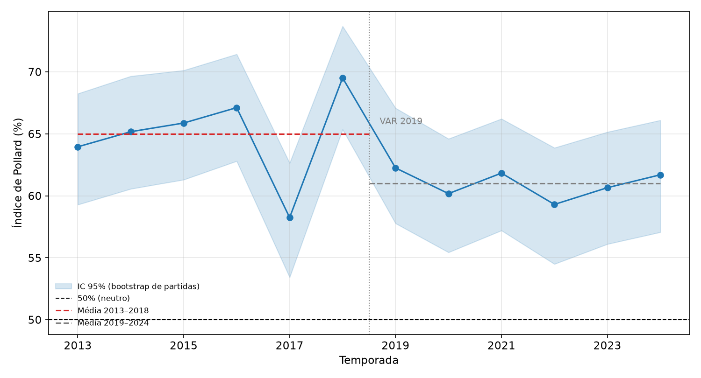
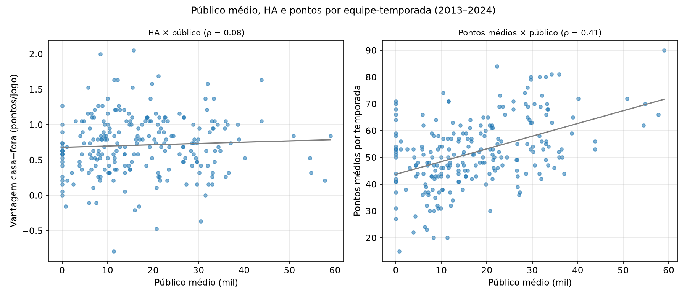
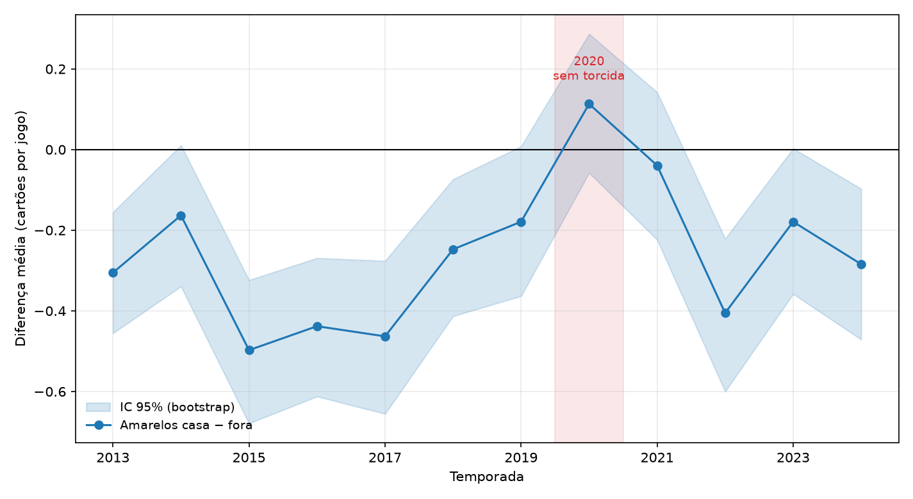

# Resumo para o Professor Barboza — artigo final

Professor Barboza,

Depois da nossa conversa sobre o formato, fechei o trabalho como artigo no recorte **2013–2024**, usando a base de partidas do `BrazilianFootball/Data` (MIT), em vez da monografia extensa. O texto está em inglês, em português e em formato ABNT; este resumo resume o que ficou pronto, os números principais e o que ainda depende do senhor.

## A pergunta

Qual foi a magnitude da vantagem de jogar em casa no Campeonato Brasileiro Série A entre 2013 e 2024, como ela variou entre temporadas e clubes, e quais fatores contextuais estão associados a essa variação. O estudo é descritivo e observacional: não testa causalidade nem faz previsão de resultados.

## O que o artigo entrega

1. **Base e validação.** 4.559 partidas válidas, 12 temporadas (2013–2024), extraídas do `BrazilianFootball/Data` (MIT), com regras de limpeza documentadas e verificação de integridade. Validação contra o OpenFootball (CC0): **2.658 de 2.660 placares idênticos (99,92%)**, uma divergência de placar e uma exceção de data documentadas; **12/12 campeões** recalculados.

2. **Nível e mudança.** O mandante conquistou **63,0%** dos pontos (IC 95% 61,7–64,3), contra 50% de neutralidade. A série cai de **65,0% em 2013–2018 para 61,0% em 2019–2024** (diferença de 4,0 p.p.; IC bootstrap por cluster 0,9–6,6), com ponto de quebra estimado em **2019**. Em 2020, sem torcida, o índice foi **60,2%**; em 2022–2024, com público de volta, **60,6%**. O retorno da torcida não restaurou o patamar anterior.

3. **Gols.** O modelo de Poisson de ataque–defesa separa a qualidade das equipes do efeito de jogar em casa. O multiplicador de gols do mandante caiu **12,0%** (de 1,565 para 1,377; IC −18,1% a −5,5%), e o prêmio de gols em casa caiu de **+56,5% para +37,7%** (18,8 p.p.; 33,3% de redução relativa). A interação é negativa e precisa (coeficiente em log −0,128; EP 0,037; IC −0,200 a −0,056; p < 0,001).

4. **Heterogeneidade.** Apenas **2,2%** da variância da vantagem por equipe-temporada está entre equipes; os 97,8% restantes são variação equipe-temporada. A decomposição não estima parâmetros por clube: um modelo hierárquico seria necessário para separar efeitos persistentes de ruído, e rankings de "quem tem mais vantagem em casa" são pouco confiáveis com 12 temporadas.

5. **Contexto e público.** Distância, clássico e estádio explicam pouco. O público tem associação fraca com a vantagem de casa (ρ = 0,08) e forte com a força do clube (ρ = 0,41); excluir os 30 zeros esparsos de público não muda o padrão (0,08 e 0,39). Os dados são compatíveis com a torcida como um dos possíveis canais, mas não identificam seu efeito.

6. **Cartões e pênaltis.** Em 2019, o mandante recebia 0,18 amarelo a menos que o visitante; em 2020, a diferença passou a +0,11. Com efeitos fixos de equipe, a mudança é **+0,35** (IC 95% −0,03 a +0,72), ainda imprecisa. Pênaltis convertidos no piloto 2019–2020 (n = 760): **+0,05** por jogo (IC 95% −0,06 a +0,15), sem mudança detectável; a fonte não registra pênaltis perdidos.

## O que mudou em relação à proposta

- O modelo de Poisson e a mudança de nível formal, que estavam na lista de próximos passos, entraram no artigo e sustentam os resultados principais.
- O modelo hierárquico bayesiano para a vantagem por equipe continua como agenda: com 12 temporadas, ele quantificaria a incerteza por clube, mas não é necessário para a conclusão central.
- O texto não afirma causalidade. A queda de 2019 coincide com o VAR e antecede a pandemia; 2020–2021 mudou torcida, calendário e protocolos ao mesmo tempo. Os canais seguem confundidos, e o artigo trata isso como limitação, não como identificação.

## Arquivos para avaliação

| Arquivo | Conteúdo | Páginas |
|---|---|---:|
| `docs/artigo_2013_2024.pdf` | artigo em inglês | 9 |
| `docs/artigo_2013_2024_pt.pdf` | artigo em português | 10 |
| `docs/artigo_2013_2024_abnt.pdf` | artigo em ABNT (NBR 6022/6023) | 16 |
| `docs/artigo_2013_2024_abnt_completo.pdf` | capa + folha de rosto + avaliação + artigo | 19 |
| `docs/resumo_artigo_orientador.pdf` | este resumo | 3 |

O pacote ABNT começa o artigo na página 4; a capa, a folha de rosto e a folha de avaliação estão nas páginas 1–3. Os placeholders de nome, titulação, instituição, data e nota da banca continuam explícitos para preenchimento posterior. O código, as tabelas derivadas e as figuras estão no repositório; a base bruta da CBF não é redistribuída.

## Pendências e decisões

1. **Template oficial UFRN/CERES-BSI** e ficha SISBI: preciso do arquivo institucional para substituir o layout provisório.
2. **Banca:** nomes, titulação, instituição, data e nota para completar a folha de avaliação.
3. **Formato de entrega:** manter as três versões (inglês, português e ABNT) ou priorizar apenas a ABNT no depósito?
4. **Seções de público e cartões:** o senhor prefere mantê-las como extensões no artigo ou deixar apenas o núcleo (Pollard, mudança e Poisson)?
5. **Dashboard:** entra como artefato complementar, com link no artigo, ou apenas como material de reprodutibilidade?

Obrigado pela leitura. Se o senhor aprovar o pacote, eu preencho a banca e aplico o template oficial assim que recebê-lo.

José Inamar de Medeiros Júnior
